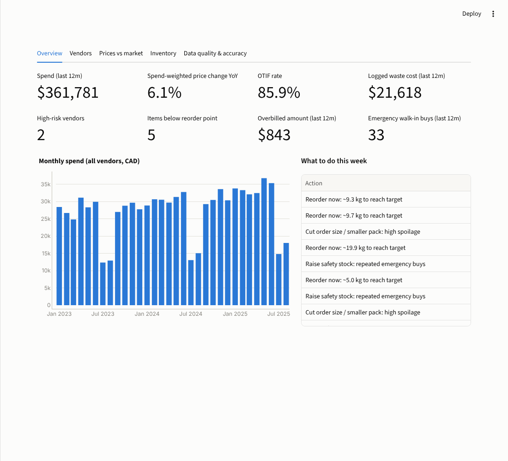
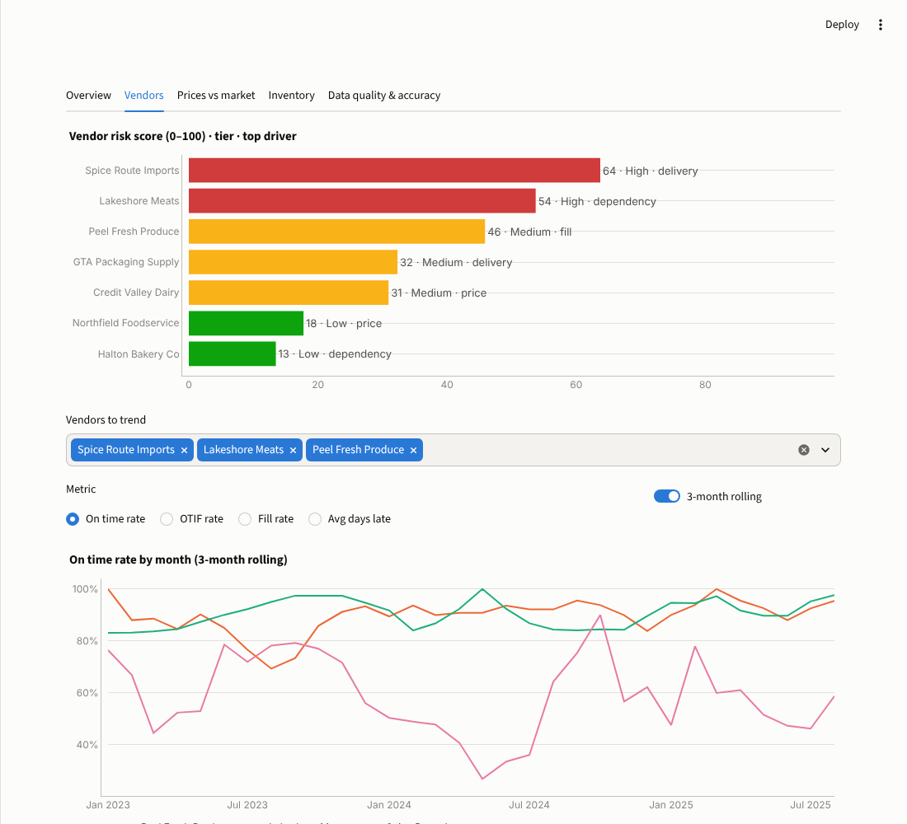
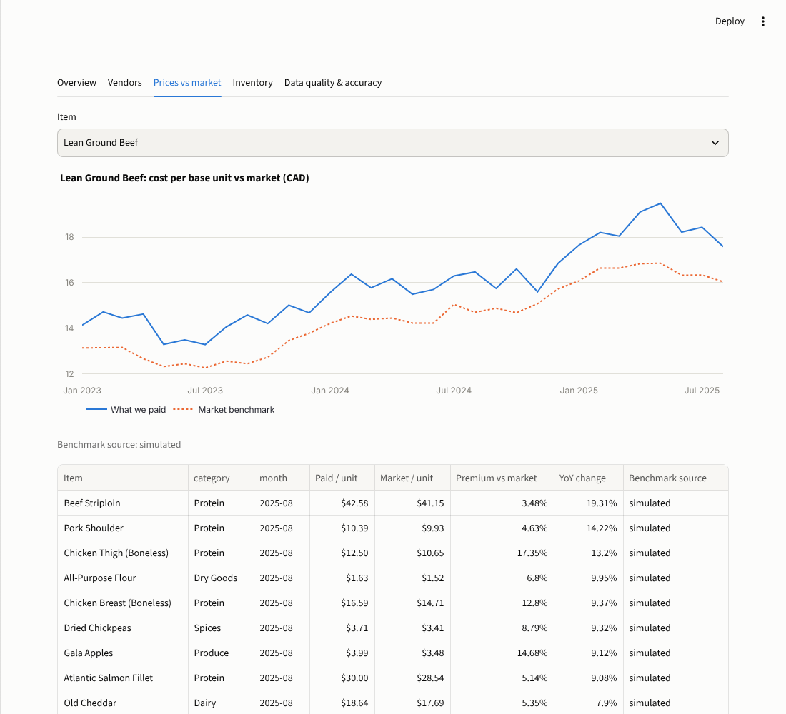
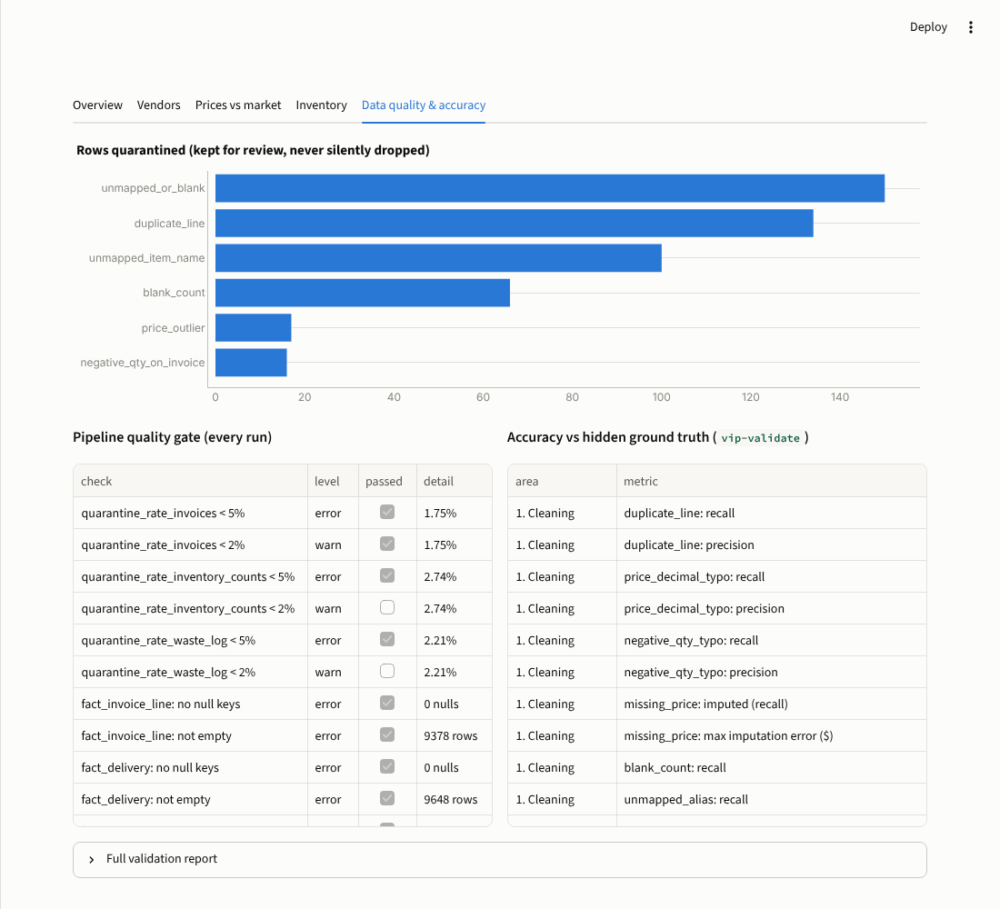

# Vendor & Inventory Risk Pipeline


A data pipeline that turns messy small-business vendor exports into decision-ready supplier-risk and inventory tables, refreshed daily, with its accuracy measured against known ground truth. It runs identically on a laptop, in GitHub Actions, and on Databricks (Free Edition is sufficient). Market prices come from real Statistics Canada open data; the transactions are simulated for reasons explained in [Why the data is simulated](#why-the-data-is-simulated).



| | |
|---|---|
| Get running in 2 minutes | [Getting started](#getting-started) · full walkthrough in [docs/SETUP.md](docs/SETUP.md) |
| Accuracy evidence | [docs/validation_report.md](docs/validation_report.md) — 19/19 gates passed against hidden ground truth |
| Reproducibility evidence | [Reproducibility](#reproducibility-and-replication) — one fingerprint across 3 OSes × 2 Python versions |
| Analyze your own data | [Use it with your own data](#use-it-with-your-own-data) |
| The build series | [Video series](#the-video-series) |

## Background

In fall 2025, a family catering kitchen and café changed owners. The previous owner's vendor and inventory history was a pile of exports: invoices with vendor names spelled 29 different ways, four date formats in one column, prices stored as `"$1,234.50"` strings, pounds mixed with kilograms, count sheets reading `chkn brst` — and no usage records at all, because the kitchen cooked from memory.

The new owners needed answers those files could not give directly:

* Which suppliers are a risk right now, and why?
* Are we being billed for product that never arrived?
* What are we overpaying relative to the market?
* What do we actually use each week, and what should we reorder today?

This repository is a rebuild of that project. The original data belongs to the business, so `simulate.py` recreates it: a day-by-day model of the kitchen (seasonal demand, ordering, late and short deliveries, spoilage, weekly hand counts) exported with the same defects real small-business systems produce.

## Use cases

**Analyze your own purchasing and inventory data.** Any operation that buys from vendors and holds stock — a restaurant, retailer, workshop, clinic — produces the same six kinds of records this pipeline ingests. Put your exports in the documented layout, validate them with `vip-check-data`, and the same cleaning, risk scoring, and dashboard apply. Everything runs locally; no data leaves your machine. See [Use it with your own data](#use-it-with-your-own-data).

**A reference implementation to learn from or build on.** The repository demonstrates, end to end: a medallion (bronze/silver/gold) architecture in plain pandas, defensive data cleaning with quarantine instead of silent drops, a data quality gate wired into CI, accuracy validation against ground truth, cross-platform reproducibility checks, one codebase targeting both local files and Databricks Delta tables, and scheduled daily refreshes. Each concern lives in its own small module.

**A teaching and interview dataset with an answer key.** The simulator writes the true answers (real usage, injected errors, overbilled lines) to a folder the pipeline never reads. That makes it useful for practicing or teaching data cleaning: every technique can be scored, not just eyeballed. Break something deliberately — lower the fuzzy-match cutoff in `silver.py`, delete a cleaning rule — and watch the validation gates fail with numbers attached.

**Daily operations, automated.** With the scheduled workflows enabled, every morning the pipeline lands yesterday's activity, rebuilds every table, re-scores accuracy, and publishes headline KPIs and recommended actions (reorder quantities, vendors to watch, billing exceptions) to the run summary — the same tables a Power BI report can consume.

## Architecture

```
 vendor exports (CSV / JSONL)          Databricks job (daily, serverless)                 Power BI
 ─────────────────────────────        ─────────────────────────────────────────────     ─────────────
 invoices, POs, receiving log,  ──▶   bronze  ──▶  silver  ──▶  gold  ──▶ DQ gate  ──▶  vendor risk
 hand counts, waste log,              raw as-is   cleaned,    metrics             inventory health
 market benchmark                                 conformed,                      price vs market
                                                  quarantine
            ▲                                                                ▲
            └──────── GitHub Actions: lint → tests → full run → deploy bundle ┘
```

* **Bronze** — raw files landed as-is, every column a string, stamped with source file and load time, so silver logic can always be replayed from the originals.
* **Silver** — cleaned and conformed: one ID per vendor and item, one base unit, explicit date parsing, duplicates and typos caught. Rows that cannot be confidently fixed go to `silver_quarantine` with a `_reason`; nothing is silently dropped.
* **Gold** — one table per business question (below), written as Parquet and CSV locally, and as Delta tables on Databricks.
* **Quality gate** — `quality.py` fails the run, and the CI build, if quarantine rates or null keys cross thresholds.

## What it produces

| Gold table | Question it answers |
|---|---|
| `vendor_risk` | Which suppliers are a risk right now, and why? (0–100 score from six explainable signals) |
| `vendor_scorecard_monthly` | On-time, in-full, OTIF, fill rate, lead time, and spend per vendor per month |
| `billing_exceptions` | Where were we billed for product that never arrived? |
| `item_price_monthly` | What are we paying per kg/L/each versus the market benchmark? Month-over-month and year-over-year change |
| `inventory_weekly` | What did we actually use each week? (reconstructed from counts, since usage is never recorded) |
| `inventory_health` | Safety stock, reorder point, days of cover, waste rate, ABC class, recommended action |
| `kpi_summary` | Headline numbers for dashboard cards |
| `dim_vendor`, `dim_item`, `dim_date` | Star-schema dimensions for Power BI |

## Data problems it handles

All of these are injected deliberately by the simulator, so detection can be measured:

* Vendor names typed 29 different ways (`NORTHFIELD FOODSERVICE INC`, `northfield`, `G.T.A. PACKAGING`) — normalized, fuzzy matched, then cross-checked against the SKU's vendor
* Four date formats in one column — parsed against an explicit format list, never guessed
* `"$1,234.50"` strings; missing prices (imputed from line totals and flagged); decimal-shift typos caught by a rolling-median outlier check
* Re-sent invoices (duplicate lines) and negative quantities on normal invoices
* Pounds, kilograms, cases, and dozens — converted to one base unit per item via the vendor catalog
* Count sheets reading `chkn brst`, `  AP FLOUR `, `cukes` — mapped through an alias table; anything unmapped is quarantined
* A waste log staff fill in only about 75% of the time — unlogged waste is still accounted for, surfacing as shrink inside derived usage

## Getting started

```bash
python -m venv .venv && source .venv/bin/activate      # Windows: .venv\Scripts\Activate.ps1
pip install -e ".[dev,dashboard]" -c requirements-lock.txt
vip-refresh --base data              # simulate -> bronze -> silver -> gold -> validate (~15s)
streamlit run dashboard/app.py       # dashboard on http://localhost:8501
pytest -q                            # 23 tests
```

| Command | Purpose |
|---|---|
| `vip-land-raw` | generate the messy vendor exports (`--end today`, `--market real/simulated/auto`, `--seed`, `--scale`) |
| `vip-run-pipeline` | bronze → silver → gold, plus the data quality gate |
| `vip-validate` | score outputs against hidden ground truth; writes the report; exits non-zero on a failed gate |
| `vip-fetch-market` | download the StatCan tables and print the item-to-series mapping |
| `vip-check-data` | validate your own data against the raw contract before running the pipeline |
| `vip-refresh` | land, run, and validate in one step |

Useful variations:

* **Different history:** `vip-refresh --base data --seed 7` generates a different but equally valid 2.7 years. Validation passes on any seed.
* **Different business size:** `--scale 0.25` produces a business under $100k annual spend; `--scale 3` a larger one. The dashboard sidebar has the same control.
* **Live mode:** `vip-refresh --base data --end today --market auto` simulates through yesterday, using real StatCan prices when reachable.
* **VS Code:** `.vscode/tasks.json` exposes all of the above as one-click tasks (`Ctrl/Cmd+Shift+B` runs a full refresh), and a debugger configuration breaks inside the cleaning rules. A `.devcontainer` makes GitHub Codespaces work with no local installs. Details in [docs/SETUP.md](docs/SETUP.md).

### The dashboard

Five tabs — Overview, Vendors, Prices vs market, Inventory, Data quality & accuracy — reading the same gold tables Power BI will use, so its layout doubles as the specification for the Power BI rebuild in Episode 2. Each tab explains its own metrics: tooltips on every KPI, and expanders describing how the risk score and inventory calculations work.

| Vendors | Prices vs market | Data quality |
|---|---|---|
|  |  |  |

To publish a free hosted copy: push the repository, create an app on [share.streamlit.io](https://share.streamlit.io) pointing at `dashboard/app.py`, and set `VIP_LIVE = "1"` in the app secrets. The public link then always shows data through yesterday with real StatCan prices.

### Run it on Databricks (Free Edition)

```bash
databricks auth login --host https://<your-workspace>.cloud.databricks.com
databricks bundle validate
databricks bundle deploy -t dev
databricks bundle run vendor_inventory_pipeline -t dev
```

The job creates the `vendor_inventory` schema and a `raw` volume, lands the exports there, and writes every layer as Delta tables (`workspace.vendor_inventory.gold_vendor_risk`, and so on). Only `storage.py` differs between laptop and Databricks; the pipeline code is identical. `notebooks/01_explore_gold.py` walks through the results. Free Edition limits that matter here: serverless only, five concurrent job tasks maximum (this job uses two), non-commercial use.

## How accuracy is proven

The simulator's advantage is that the true answers are known. Real usage, true waste, every injected error, and every overbilled line are written to `raw/_truth/`, a folder the pipeline never reads. `vip-validate` scores the pipeline's outputs against it and fails the build if any gate drops:

| What is checked | How | Current result |
|---|---|---|
| Cleaning catches the injected errors | precision/recall per error type (duplicates, decimal typos, negative quantities, missing prices, blank counts, unknown names) | 100% / 100% on every type |
| Money reconciles | cleaned spend plus quarantined spend vs the true invoice total | 0.0002% unexplained |
| Usage reconstruction is correct | weekly derived usage vs true stock drawdown | 5.4% WMAPE, r = 0.996 |
| Vendor metrics measure what is real | measured on-time / in-full rates vs the generator's parameters (z-test) | all \|z\| < 3 (within sampling error) |
| Billing exceptions are real | flagged vs truly overbilled lines | 100% precision, 100% recall |
| The stockout signal works | emergency buys vs true stockout days (rank correlation) | ρ = 0.84 |

The full report is [docs/validation_report.md](docs/validation_report.md). To see the gates work, lower the fuzzy-match cutoff in `silver.py` from 0.6 to 0.3 and rerun `vip-validate`; the gate fails locally and CI turns red on the push. Running with different seeds (`vip-refresh --seed 1`, `--seed 2`, …) passes on all of them, so the results are not cherry-picked.

A precise statement of scope: the validation proves the *code* is correct — given data with these defects, it recovers the right answers. It does not prove the risk-score *weights* are optimal; those are documented judgment calls, fixed and reported per component.

### Why the data is simulated

No public dataset contains a real business's invoices, deliveries, and hand counts together; that data is private everywhere, including at the original business. Simulating the process — not the spreadsheet — is what makes it possible to inject known errors and then measure whether the pipeline catches them. The market benchmark, by contrast, is real: `real_data.py` pulls Statistics Canada monthly average retail prices (table 18-10-0245-01, Ontario) and CPI (18-10-0004-01), and the pipeline uses the real price movement so simulated vendor prices follow real-world swings. Every benchmark row records the exact StatCan series it came from.

## Reproducibility and replication

To replicate the published results exactly:

```bash
git clone https://github.com/ssivasa10033/Vendor-Inventory-Risk-Pipeline && cd Vendor-Inventory-Risk-Pipeline
python -m venv .venv && source .venv/bin/activate
pip install -e ".[dev]" -c requirements-lock.txt
vip-refresh --base data --market simulated     # deterministic: no network dependency
```

The run should end with gold fingerprint `9f0e8c244f097eef` and 19/19 validation gates passed, matching [docs/validation_report.md](docs/validation_report.md). The guarantees behind that:

* **Pinned dependencies** in `requirements-lock.txt` and a fixed random seed (vary it deliberately with `--seed`).
* **CI matrix:** tests, the full pipeline, and validation run on Ubuntu, Windows, and macOS × Python 3.10 and 3.12 on every push.
* **Fingerprinting:** a SHA-256 of every gold table in canonical form is computed in each environment; the `reproducibility` job fails unless all six match, and writes the comparison table to the run summary.
* **Scale invariance:** CI also runs the full pipeline and every validation gate at `--scale 0.25` (a business under $100k/year), so the metrics are proven correct at more than one business size.
* **Stable history:** extending the end date never changes earlier files, because each month has its own random stream. A test enforces this; it is what makes the daily live mode trustworthy.
* **One codebase, three runtimes:** laptop, GitHub Actions, and Databricks serverless, differing only in the storage backend.
* **Devcontainer** for an identical environment anywhere, including Codespaces.

Note that running with `--market auto` or `--market real` produces a different (still deterministic for a given StatCan vintage) fingerprint, because real market data enters the gold tables.

## Use it with your own data

The pipeline is not tied to the simulator. Bronze ingests anything matching the raw contract:

```
my-data/raw/
  reference/vendor_master.csv        who you buy from (IDs and canonical names)
  reference/item_master.csv          what you buy (IDs, categories, base units)
  reference/vendor_catalog.csv       vendor SKU -> item, pack size, unit
  reference/item_aliases.csv         how items appear on count sheets
  purchase_orders/*.csv              what was ordered
  receiving/*.jsonl                  what arrived, and when
  invoices/*.csv                     what was billed
  inventory_counts/*.csv             periodic hand counts
  waste/*.csv                        the waste log (gaps are fine)
  market/*.csv                       market benchmark (see the guide for options)
```

1. Run `vip-refresh` once — the simulator's output in `data/raw/` is a working template of every schema.
2. Replace the four `reference/` tables with your real vendors, items, units, and count-sheet aliases, and drop your exports into the matching folders.
3. `vip-check-data --base my-data` validates everything before you run: structure and required columns, date and money formats, and cross-file consistency (invoice SKUs against the catalog, count-sheet names against the aliases, receipts against POs), with specific messages for anything wrong.
4. `vip-run-pipeline --env local --base my-data`. The quality gate still applies: anything that cannot be conformed lands in `silver_quarantine` with a reason.

The dashboard offers the same flow without a terminal: the sidebar's "Use your own data" panel runs the checker interactively, then runs the pipeline and switches the dashboard to your dataset. Everything stays on your machine.

The complete schema guide — every column, accepted formats, what to do without a market benchmark — is [docs/use-your-own-data.md](docs/use-your-own-data.md). Two things change with real data: `vip-validate` does not apply (it scores against the simulator's hidden truth; with real data the checks are the quality gate, the tests, and reconciliation against your accounting totals), and the July/August planning exclusion in `gold.py` should be adjusted to your own seasonality.

## CI/CD

`.github/workflows/ci-cd.yml`, on every push and pull request:

1. **Lint** (ruff), then on all six OS/Python combinations: tests → full pipeline run with the quality gate → `vip-validate` accuracy gates → gold fingerprint, plus the quarter-scale validation run on one leg
2. **Reproducibility** — fails unless all six fingerprints are identical, and writes the comparison table to the run summary
3. **Deploy** (pushes to `main` only) — `databricks bundle validate`, `deploy -t prod`, then one run; the job skips itself until the `DATABRICKS_HOST` and `DATABRICKS_TOKEN` repository secrets exist

`.github/workflows/live.yml`, every morning (about 6:17 Toronto time): lands yesterday's activity with real StatCan prices, rebuilds every table, re-scores accuracy, and posts the KPIs and top recommended actions to the run summary. The Databricks job mirrors this at 6:00 with `--end today`.

## Repository layout

```
src/vendor_pipeline/
  config.py      vendors, items, inflation profile (the simulated "business")
  simulate.py    day-by-day kitchen simulation + messy exports + hidden truth
  storage.py     LocalStorage / DatabricksStorage (same pipeline code, two backends)
  bronze.py      land raw files as-is with lineage columns
  silver.py      clean, conform, convert units, quarantine
  gold.py        vendor risk, billing exceptions, prices, inventory health, KPIs
  quality.py     data quality gate
  checkdata.py   contract checker for user-supplied data (vip-check-data)
  pipeline.py    orchestration
  real_data.py   Statistics Canada fetch + item-to-series mapping (real market prices)
  validate.py    accuracy scoring against hidden ground truth + reproducibility fingerprint
  jobs.py        CLI entry points (used locally, in CI, and as Databricks wheel tasks)
dashboard/app.py              Streamlit dashboard (the pre-Power BI view)
tests/                        23 tests: cleaning rules, pipeline, StatCan fetcher, data contract, stable history
.vscode/ .devcontainer/       one-click tasks, debugger configs, Codespaces environment
.github/workflows/            CI/CD matrix + daily live run
databricks.yml + resources/   asset bundle + job definition (daily 6am Toronto, serverless)
notebooks/01_explore_gold.py  exploration notebook for the Databricks walkthrough
docs/                         setup guide, validation report, own-data guide, episode outline, screenshots
```

## How the key metrics work

* **Derived usage:** `opening count + received − logged waste − closing count`. Unlogged waste is counted as usage (shrink), which is realistic — and measurable here: validation shows it adds about 2% over true usage. A test checks derived usage against the hidden truth (correlation above 0.9).
* **Safety stock** (periodic review, 95% service level): `1.65 × √((L + R)·σd² + d²·σL²)`, where `d` is daily usage, `L` lead time, and `R` the review period — all measured from the data, not assumed.
* **Reorder point:** `d·L + safety stock`, compared against inventory *position* (on hand plus on order), not just on hand.
* **Planning usage excludes July and August:** the handover happened in August, and summer volumes would understate what September needs.
* **Vendor risk score:** a weighted 0–100 from delivery reliability (25%), price volatility and year-over-year change (20%), spend dependency (20%), fill rate (15%), lead-time variability (10%), and overbilling (10%). The weights are fixed, documented, and reported per component.
* **Recommended actions:** each item passes through a fixed priority ladder — below reorder point, high waste, repeated emergency buys, risky primary vendor, overstocked — and the first rule that fires wins. Every number in an action is measured from that item's own history.

## The video series

This repository is being built in public as a YouTube series for people who know some Python but have not yet shipped a production-style data pipeline:

| Episode | Topic | Status |
|---|---|---|
| 1 | Messy exports to trusted risk tables: the simulator, the medallion pipeline, proving accuracy, Databricks, CI/CD | in production — [outline](docs/episode-01-outline.md) |
| 2 | Power BI on the gold tables: rebuilding the dashboard the owners actually used | planned |

Links will appear here as episodes publish.

---

Built by Seon Siva. Questions and issues are welcome — open one on this repository.
